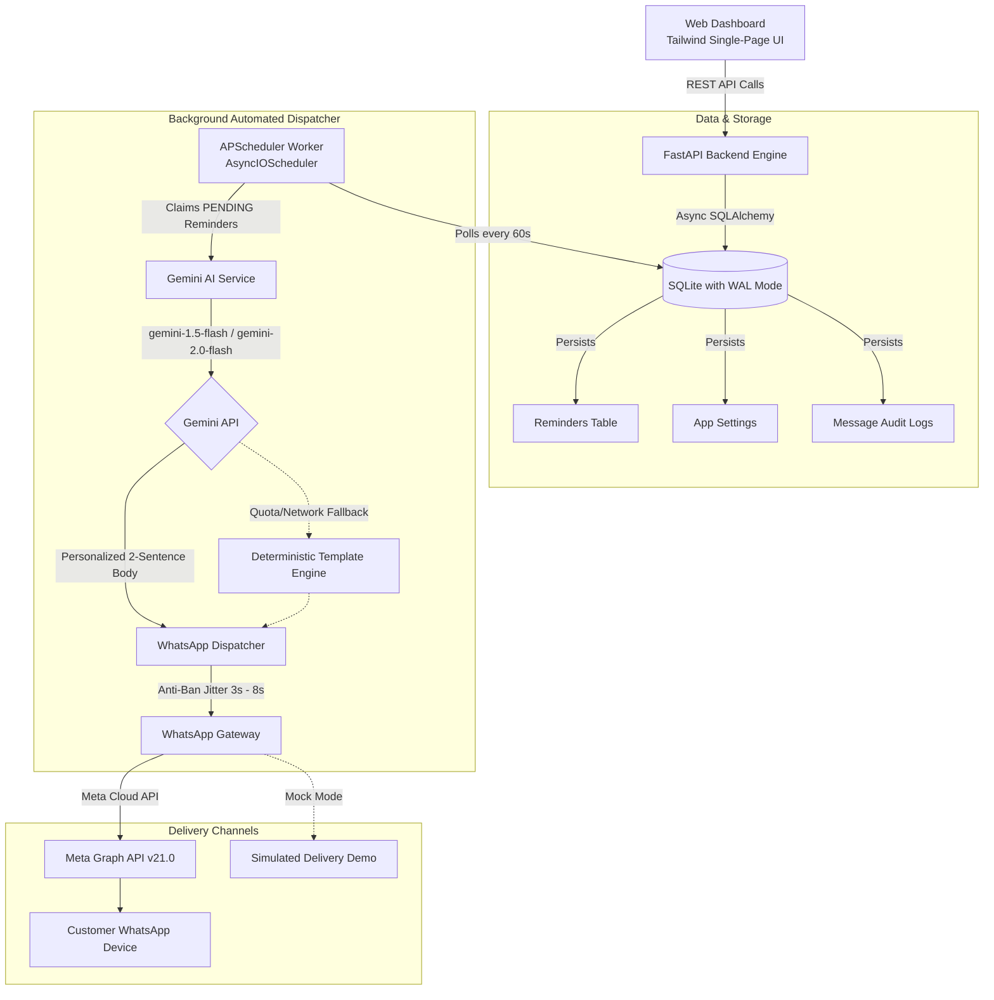

# 📱 WhatsApp AI Reminder Agent — SaaS Dashboard & Engine

A complete, sellable, white-label SaaS web tool and automation backend built with **FastAPI**, **Tailwind CSS**, **SQLite (SQLAlchemy)**, **APScheduler**, and **Google Gemini AI**.

Engineered specifically to sell to **non-technical business owners** (clinics, salons, consultants, wellness centers, and law firms) with zero required coding knowledge. Non-technical clients can manage appointments, customize AI message tones, preview Gemini messages live, and plug their WhatsApp credentials right from the Web Dashboard.

---

## 🚀 Live Web Dashboard Highlights

- **Modern Single-Page Dashboard**: Built with responsive HTML5, Tailwind CSS, and Vanilla JavaScript with Dark/Light theme mode.
- **Drag-and-Drop Contact Upload**: Supports both **CSV** and **Excel (.xlsx)** spreadsheets with sample template download.
- **Manual Quick-Add Form**: Rapidly schedule individual appointments with date-picker and lead-time presets (24h before, 2h before, or immediate).
- **AI Tone Controls & Live Sandbox**:
  - **Dropdown tones**: *Friendly & Warm*, *Polite & Formal*, *Urgent Reminder*, *Empathetic & Caring*, *Casual & Relaxed*.
  - **Live AI Preview**: Generates instant previews of what Gemini writes before scheduling or sending.
  - **Smartphone Chat Mockup**: Visualizes exactly how the message appears inside a real WhatsApp chat bubble with blue double checkmarks.
- **Live Reminders Table**:
  - Real-time search across customer names, phone numbers, and service categories.
  - Status filters (*Scheduled/Pending*, *Delivered*, *Delivery Failed*).
  - Row action buttons to trigger **Instant Send**, **View AI Message**, or **Delete/Cancel**.
- **In-App WhatsApp Settings Tab**:
  - Configure Meta WhatsApp Phone Number ID and System User Access Token directly from the browser.
  - Integrated credential test buttons to verify WhatsApp and Google Gemini connectivity with 1 click.
  - Settings stored securely in SQLite database (no need to restart or edit `.env` files).
  - Built-in **Mock Gateway mode** for client sales demonstrations with $0 API costs.

---

## 🏗️ Technical Architecture



---

## 📂 Project Folder Structure

```
REMINDER AI AGENT/
├── app/
│   ├── __init__.py
│   ├── main.py                  # FastAPI app serving Web Dashboard, static assets & API routes
│   ├── config.py                # Pydantic Settings & environment variables
│   ├── database.py              # SQLite + SQLAlchemy async models (Reminders, AppSetting, Client)
│   ├── scheduler.py             # APScheduler background automated dispatch loop
│   ├── schemas.py               # Pydantic schemas (Reminders, BulkUpload, AIPreview, Settings)
│   ├── routes/
│   │   ├── __init__.py
│   │   ├── reminders.py         # Reminders CRUD, CSV/Excel upload, AI preview, send-now
│   │   ├── settings.py          # Dashboard settings & live credential test endpoints
│   │   ├── clients.py           # Multi-tenant business management
│   │   └── webhooks.py          # Meta WhatsApp delivery receipts and inbound callbacks
│   ├── services/
│   │   ├── __init__.py
│   │   ├── gemini_service.py    # Google Gemini personalization logic + tone fallback engine
│   │   └── whatsapp_service.py  # WhatsApp Cloud API (Graph API) + Mock gateway adapter
│   ├── templates/
│   │   └── index.html           # Complete Tailwind CSS Web Dashboard
│   └── static/                  # Static assets directory
├── main.py                      # Root entrypoint (re-exports app for uvicorn main:app)
├── sample_reminders.csv         # Ready-to-use sample CSV template
├── test_api.py                  # End-to-end automated test suite
├── test_app.py                  # Component verification test suite
├── requirements.txt             # Python production dependencies
├── .env.example                 # Environment configuration template
└── README.md
```

---

## ⚡ Quickstart & Setup

### 1. Prerequisites
- Python 3.10+ (tested on Python 3.12)
- Pip package manager

### 2. Install Dependencies
```bash
pip install -r requirements.txt
```

### 3. Launch the Application
Run using the standard root command:
```bash
uvicorn main:app --reload
```
*(Or alternatively: `uvicorn app.main:app --reload`)*

The server will initialize SQLite database tables and start the background dispatch scheduler automatically:
- **Web Dashboard**: Open [http://localhost:8000](http://localhost:8000) in your browser.
- **Interactive Swagger API Docs**: [http://localhost:8000/docs](http://localhost:8000/docs)
- **Health Check Status**: [http://localhost:8000/health](http://localhost:8000/health)

---

## 🛠️ Step-by-Step Client Setup (Non-Technical Guide)

1. **Access Dashboard**: Open `http://localhost:8000`.
2. **Go to Settings Tab**:
   - **Gateway Mode**: Choose `Official Meta WhatsApp Cloud API` (or leave as `Mock Mode` for an instant risk-free demo).
   - **Phone Number ID**: Paste your Meta Phone Number ID.
   - **WhatsApp Access Token**: Paste your Meta Permanent System User Access Token.
   - **Google Gemini API Key**: Paste your free key from [Google AI Studio](https://aistudio.google.com).
   - **Business Name & Type**: Enter your clinic or salon name (e.g. *SmileCraft Dental*, *Luxe Hair Salon*).
   - Click **Test WhatsApp Connection** and **Test Gemini AI Key** to verify green checkmarks.
   - Click **Save All Settings**.
3. **Add Appointments**:
   - Navigate to **Upload & Add Appointments**.
   - Either fill out the **Add Single Appointment** form or drag and drop a **CSV / Excel** file.
   - Download the pre-formatted sample file using the **Sample CSV** button.
4. **Live Preview & Test**:
   - Use the **AI Tone & Live Preview** tab to test message styling in real-time.
   - On the **Live Reminders Table**, click the **⚡ Send Now** icon on any row to test an immediate WhatsApp dispatch.

---

## 📊 CSV & Excel Spreadsheet Column Format

| Column Name | Required | Description | Example |
| :--- | :--- | :--- | :--- |
| `name` | Yes | Customer or patient full name | `Sarah Jenkins` |
| `phone` | Yes | Recipient phone with country code | `+14155552671` |
| `service_name` | Yes | Scheduled service or treatment | `Teeth Cleaning & Polish` |
| `appointment_datetime` | Yes | Date and time (ISO or YYYY-MM-DD HH:MM) | `2026-10-15 14:30:00` |
| `notes` | No | Preparation instructions | `Please fast 2 hours prior` |
| `tone` | No | friendly, formal, urgent, empathetic, casual | `friendly` |
| `lead_hours` | No | Hours before appointment to dispatch | `24` |

---

## 🧪 Automated Testing

Verify the complete stack (database, endpoints, templates, Gemini fallback, and gateway):
```bash
python test_api.py
```
Expected output:
```
==================================================
RUNNING COMPREHENSIVE END-TO-END SaaS TESTS...
==================================================
[1] Testing GET / (Web Dashboard): [OK]
[2] Testing GET /health: [OK]
[3] Testing POST /api/ai/preview: [OK]
[4] Testing POST /add-reminder: [OK]
[5] Testing POST /bulk-upload (CSV): [OK]
[6] Testing GET /reminders: [OK]
[7] Testing POST /reminders/{id}/send-now: [OK]
[8] Testing GET and POST /api/settings: [OK]
[9] Testing DELETE /reminders/{id}: [OK]
==================================================
ALL SaaS TESTS PASSED PERFECTLY!
==================================================
```

---

## 💼 How to Sell This to Local Businesses

1. **Offer a "No-Show Reduction Guarantee"**:
   - Clinics and salons lose 15-20% of revenue to missed appointments.
   - Standard SMS reminders are dry and often ignored.
   - AI-personalized WhatsApp messages have a 98% open rate and 45%+ confirmation response rate.
2. **Pricing Model**:
   - **Setup Fee**: $299 - $500 (one-time onboarding, importing customer list, setting up WhatsApp Cloud API).
   - **Monthly Retainer**: $79 - $149/month for hosting, automated reminder dispatch, and support.
3. **Turnkey Client Experience**:
   - The business owner simply drags and drops their weekly appointment export spreadsheet into the Web Dashboard on Monday morning.
   - The AI agent automatically calculates lead hours, personalizes each reminder, and dispatches on schedule.
